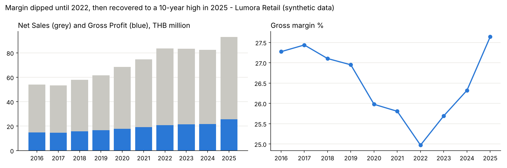
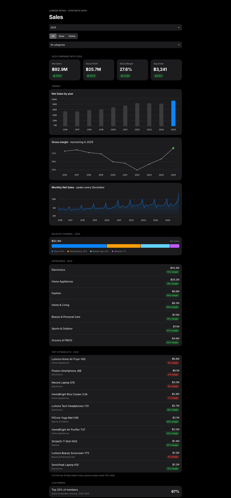

# Retail Sales Analysis: Why Did Margin Dip, and How Did It Recover? (2016–2025)

> **Synthetic data disclaimer** — All data in this project is **synthetic**. It was generated by `generate_data.py` (fixed seed 42) for a fictional retailer, *Lumora Retail*. No real company or customer data is used.



## 1. Business Question

> *"Our gross margin fell from 27.4% in 2017 to 25.0% in 2022, then recovered to 27.6% in 2025. What caused the dip, what drove the recovery, and what should we do next to keep margin growing?"* — Head of Sales (fictional)

Sub-questions:

1. How have sales, gross profit and margin changed over 10 years?
2. Which categories, products and channels sell a lot but make little profit?
3. Who are our most valuable customers, and do new customers come back?
4. Do promotions help or hurt profit?
5. What sales can we expect in 2026?

## 2. Key Findings

- **Dip and recovery:** Gross margin fell from 27.4% (2017) to 25.0% (2022), costing about ฿2.1M of gross profit in 2022. It then rose about 1 point a year to a 10-year high of 27.6% in 2025, worth about ฿2.5M more gross profit than at the 2022 margin.
- **Growth:** From 2022 to 2025, net sales grew 11% (฿83.7M → ฿92.9M) and gross profit grew 23% (฿20.9M → ฿25.7M).
- **What caused the dip:** Supplier costs rose faster than prices after 2021, and sales shifted to low-margin categories: Electronics and Home Appliances went from 51% of sales (2016) to 57% (2022).
- **What drove the recovery:** Lower supplier costs from 2023. Every category's margin rose 3–4 points from 2022 to 2025.
- **What still holds margin back:**
    - **Mix:** Electronics and Home Appliances are now 61% of sales but only 37% of gross profit.
    - **Low-margin best sellers:** 8 of the top 20 products have a margin under 10%; they are 27% of sales.
    - **Discounts:** The discount rate rose from 2.3% to 3.5% of sales, an extra ฿1.2M in 2025. Mega sale day orders (11.11, 12.12) make only a 6% margin vs 29% without a promotion.
    - **Marketplace fees:** Fees grew from ฿1.1M to ฿2.8M; the marketplace is 27% of sales and charges about 11.5%.
- **Customers:** The top 20% of members bring in 67% of member revenue. Only 30% of customers who first bought in 2023–2024 came back the next year, down from 43% for 2016–2019.
- **Seasonality & COVID:** December sales are 1.5× an average month. During the April–May 2020 lockdown, store sales fell 64% while online sales quadrupled. Online share grew from 7% (2016) to 57% (2025).

**Recommendations** (estimated yearly gross profit impact, 2025 base): bring discounts back to the 2022 level (+฿1.2M), raise prices 3% on the 8 low-margin best sellers (+฿0.8M), move 20% of marketplace sales to the company app (+฿0.6M), win back 10% of "At Risk" customers (+฿0.3M). **Total ≈ +฿2.9M per year.**

## 3. Dataset

*Lumora Retail* is a fictional Thai retailer with 25 stores, a website/app and a marketplace shop, selling electronics, home goods, beauty, fashion, grocery and sports products.

| Table | Rows | Description |
|---|---|---|
| orders | ~266K | Order date, channel, store, promotion, shipping, marketplace fee |
| order_items | ~575K | Product, quantity, price, cost, discount |
| customers | 52K | Member profile and signup date |
| products | 880 | Product, category, brand |
| stores | 27 | 25 stores + 2 online channels |
| promotions | 138 | Sales campaigns (11.11, 12.12, payday, seasonal) |
| returns | ~16K | Returned items |

The raw data contains deliberate quality problems: duplicate rows, four different date formats, negative prices, zero quantities, missing values and inconsistent labels. Column definitions: [`docs/data_dictionary.md`](docs/data_dictionary.md).

## 4. Tools & Steps

| Step | Tool | File |
|---|---|---|
| 1. Generate data | Python (pandas, numpy) | `generate_data.py` |
| 2. Clean data | Python (pandas) | `clean_data.py` → `reports/cleaning_log.csv` |
| 3. Answer questions in SQL | SQL (DuckDB) | `sql/analysis_queries.sql`, `run_sql.py` |
| 4. Analysis & charts | Python (pandas, matplotlib) | `analyze.py` → `outputs/`, `images/` |
| 5. Dashboard | Streamlit | `app.py` |

Analysis methods: KPI trends, category and product margin, Pareto (top 20% customers), RFM segmentation, yearly cohort retention, promotion comparison, and a simple forecast (2025 monthly sales × average growth of the last 3 years; tested on 2025 with an error of 7.6%).

## 5. Dashboard



A single-page dashboard with an iOS-inspired design (grouped white cards, segmented controls, list rows). Filters: year, channel (All / Store / Online) and category. Shows KPI cards vs the previous year, sales and margin trends, monthly sales, a channel share bar, categories and the top 10 products with their margins, and the top-20% customer share. Charts use Altair, which comes with Streamlit.

## 6. How to Run

Requires Python 3.10+. Open a terminal in the project folder and run:

```bash
python -m pip install -r requirements.txt
python -m streamlit run app.py      # opens the dashboard at http://localhost:8501
```

On the first run the app creates the synthetic data itself (about 30 seconds). To run each step of the analysis separately:

```bash
python generate_data.py   # creates data/raw/
python clean_data.py      # creates data/clean/ and reports/cleaning_log.csv
python analyze.py         # creates outputs/ and images/
python run_sql.py         # prints the result of every SQL query
```

**Troubleshooting**

- `streamlit` is not recognized: use `python -m streamlit run app.py` as shown above. This works even when the Streamlit command folder is not on your PATH.
- `python` is not recognized (Windows): replace `python` with `py` in every command.
- `No module named ...`: run `python -m pip install -r requirements.txt` first.
- On macOS/Linux you may need `python3` instead of `python`.

## 7. Project Structure

```
├── generate_data.py          # create synthetic raw data (seed 42)
├── clean_data.py             # clean the data
├── analyze.py                # analysis + charts
├── run_sql.py                # run the SQL file on the clean data
├── app.py                    # Streamlit dashboard
├── sql/analysis_queries.sql  # 9 business questions in SQL
├── docs/data_dictionary.md
├── images/                   # charts used in this README
├── outputs/                  # result tables + metrics.json
└── reports/cleaning_log.csv
```

## 8. Limitations

- The data is synthetic, so the findings show the analysis method, not real market facts.
- Recommendation impacts are rough estimates that assume sales volume stays the same.
- The forecast is a simple growth-based method, not a statistical model.

## 9. Author

[Jeeraphat Suttitheeravut] · jeeraphat.sutti@gmail.com · [www.linkedin.com/in/jeeraphat-suttitheeravut-0281b93a6]
